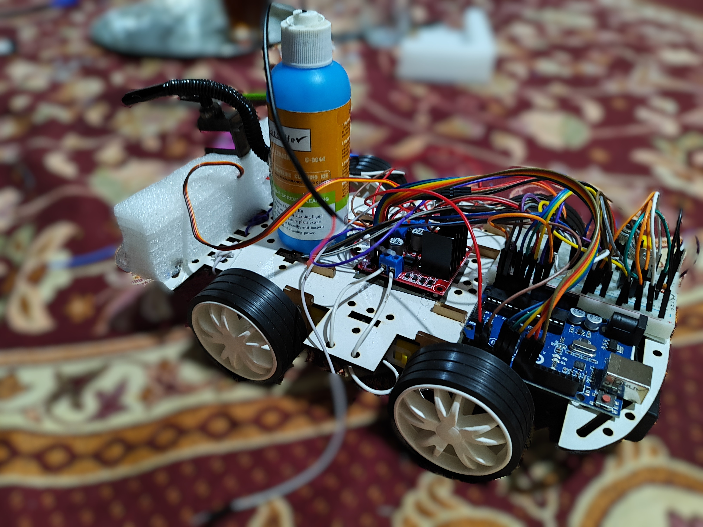
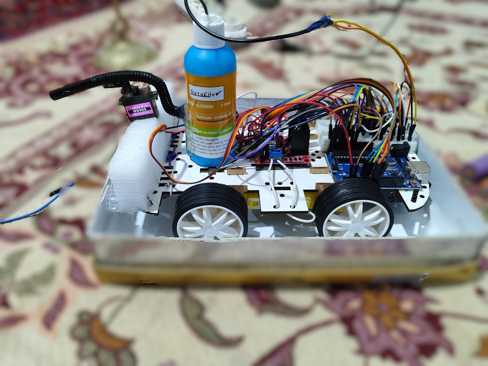
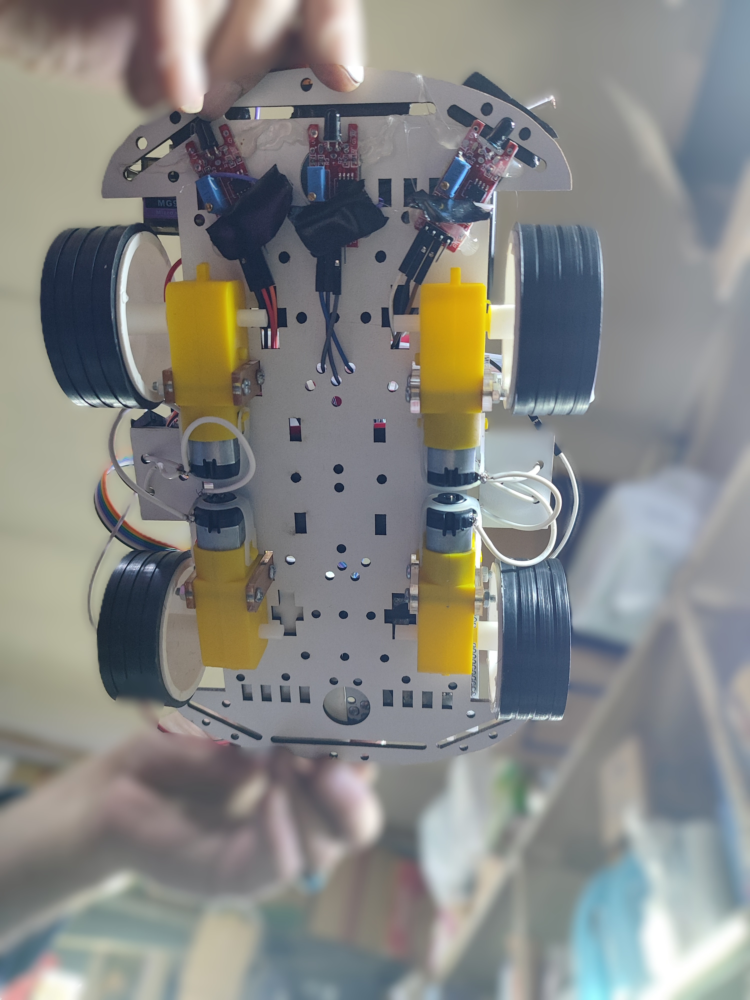

# Autonomous Firefighting Robot

## 📸 Screenshots

| Top View                                | Left View                      |    Bottom View                                  |
| --------------------------------------- | ------------------------------------------- | ------------------------------------------- |
|  | |    |

This project is an Arduino-based autonomous robot designed to detect and extinguish small fires.It uses three infrared (IR) sensors to locate flames and a water pump to put them out, making it a great project for learning about robotics and sensor integration.The robot operates autonomously but also includes optional push buttons for manual control. 

---

## ⚙️ How It Works

The robot's operation is governed by the code in the `Autonomous_Firefighting_Robot.ino` file. 
1. **Calibration**: When the robot is powered on, it takes initial readings from the three IR flame sensors to calibrate for the ambient light conditions. This helps to avoid false detections.

2.  **Fire Detection & Extinguishing**: The robot continuously reads values from the IR sensors. 
    * If a fire is detected by the front, right, or left sensor, the robot will stop. 
    * It then activates the water pump and sweeps a servo motor to aim the water stream at the fire. 

3.  **Searching Mode**: If the sensors pick up a faint IR signal, the robot enters a "searching" mode. It will move forward or turn to investigate the potential fire source. 

4.  **Idle State**: If no fire is detected, the robot remains stationary, and the water pump is turned off. 

---

## 🛠️ Components and Setup

### **Hardware Requirements**
* Arduino Board (e.g., Uno) 
* L298N Motor Driver 
* Infrared (IR) Flame Sensors (x3) 
* DC Motors (x2) 
* Servo Motor (e.g., SG90) 
* Water Pump 
* Power Supply / Battery Pack 

### **Software Requirements**
* Arduino IDE 

### **Connections & Pinout**
The components should be connected to the Arduino according to the pin definitions in the code. 

| From Component          | To Arduino Pin |
| :---------------------- | :------------- |
| **L298N Motor Driver** |                |
| Enable A (Right Motor)  | Pin 10         |
| Input 1                 | Pin 9          |
| Input 2                 | Pin 8          |
| Input 3 (Left Motor)    | Pin 7          |
| Input 4                 | Pin 6          |
| Enable B (Left Motor)   | Pin 5          |
| **Sensors & Actuators** |                |
| Right IR Sensor         | Pin A0         |
| Front IR Sensor         | Pin A1         |
| Left IR Sensor          | Pin A2         |
| Servo Motor             | Pin A4         |
| Water Pump              | Pin A5         |

---

## 🚀 Getting Started

1.  **Assemble the Hardware**: Connect the components according to the pinout table.
2.  **Upload the Code**: Open the `Autonomous_Firefighting_Robot.ino` file in the Arduino IDE. 
3.  **Install IDE**: Ensure you have the Arduino IDE installed to upload the sketch. 
4.  **Power Up**: Power the robot using the battery pack.
5.  **Test**: You can view sensor readings and status messages by opening the Serial Monitor in the Arduino IDE at a baud rate of 9600.
